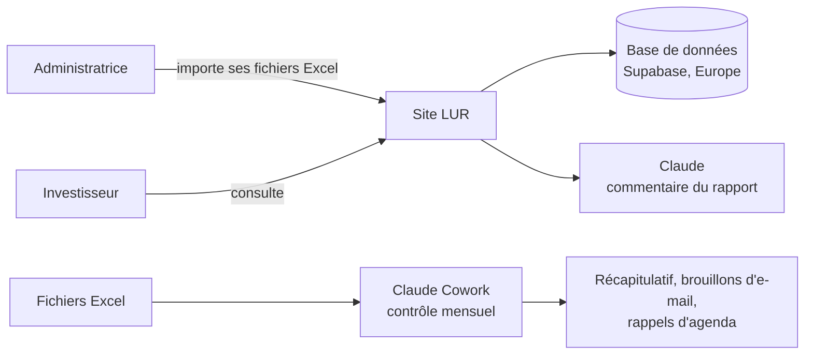

# LUR — Reporting de portefeuille immobilier

LUR est un site privé où des investisseurs (fonds, family offices) consultent leur portefeuille de bureaux en Espagne. L'operating partner qui gère ces immeubles l'alimente avec ses fichiers Excel et publie chaque trimestre un rapport commenté par l'IA.

> Projet réalisé pendant une formation de 6 semaines en vibe coding. **Toutes les données sont fictives.**

**Site** : https://gallery-of-moments.vercel.app — accès sur invitation, non référencé sur Google.

---

## Le problème

Aujourd'hui, un investisseur reçoit son reporting en morceaux : des fichiers Excel, des PDF, des e-mails, à des dates différentes. Il ne sait jamais si le chiffre qu'il lit est le dernier, ni d'où il vient.

**LUR met tout au même endroit, à jour, avec la source de chaque chiffre.**

## Qui fait quoi

| Utilisateur | Ce qu'il peut faire |
|---|---|
| **Investisseur** | Consulter son portefeuille : chiffres clés, alertes, fiche de chaque immeuble, rapports trimestriels. Il ne voit que ses propres immeubles et ne peut rien modifier. |
| **Administratrice** (l'operating partner) | Importer les fichiers Excel, produire le rapport trimestriel avec l'aide de l'IA, lancer un contrôle du portefeuille. |

## Ce que fait l'application

1. **Tableau de bord** : valeur du portefeuille, loyers, taux d'occupation, niveau d'endettement (LTV), et alertes (bail qui se termine, prêt proche de sa limite, bureau vide).
2. **Fiche immeuble** : baux et locataires, financement, business plan, documents.
3. **Import Excel** : l'administratrice dépose son fichier ; LUR le vérifie avant de l'enregistrer et indique précisément chaque erreur (onglet, ligne, correction attendue). Excel reste la référence : l'application ne recalcule rien.
4. **Rapport trimestriel** : l'IA (Claude) rédige un commentaire à partir des seuls chiffres du trimestre ; tout chiffre douteux est surligné ; l'administratrice relit et valide ; un PDF « Confidentiel » est créé.
5. **Contrôle automatique** : chaque mois, Claude Cowork vérifie les fichiers et envoie un récapitulatif à l'administratrice, avec les brouillons d'e-mails et les rappels d'agenda. Le même contrôle peut être lancé à la main depuis l'application.

## Outils utilisés

| Pour quoi | Outil |
|---|---|
| Dessiner les écrans | Stitch |
| Construire l'application | Lovable |
| Stocker les données et gérer les comptes | Supabase (hébergé en Europe) |
| Mettre en ligne | GitHub + Vercel |
| Rédiger le commentaire du rapport | Claude (API Anthropic) |
| Automatiser le contrôle mensuel | Claude Cowork |
| Tester automatiquement le site | Playwright (9 tests rejoués à chaque mise à jour) |

## Sécurité et confidentialité

- **Chaque investisseur ne voit que son portefeuille.** La règle est appliquée par la base de données elle-même, pas seulement par l'affichage. Vérifié par 6 tests manuels et 9 tests automatiques.
- **Pas d'inscription libre** : les comptes sont créés par l'administratrice.
- **Les clés secrètes ne sont jamais dans le code** : elles sont stockées dans les réglages de Vercel et de GitHub.
- **Aucun envoi sans validation** : rapports et e-mails sont relus par l'administratrice.
- Données hébergées en Europe ; site non référencé ; PDF marqués « Confidentiel ».

## Les documents du projet (dossier `docs/`)

| Je veux comprendre… | Document |
|---|---|
| Le projet en une page | `note-de-cadrage.md` |
| Les utilisateurs et leurs besoins | `personae.md`, `value-proposition-canvas-fusionnee.md` |
| Ce que fait l'application en détail | `prd.md`, `perimetre-mvp.md` |
| Les maquettes | `maquettes-stitch.md` |
| La base de données | `lur-schema-v1.1-diagramme.pdf` (schéma), `politiques-rls.md` (qui voit quoi) |
| La sécurité | `audit-securite.md` |
| L'automatisation | `workflow-cowork.md` |
| Les choix d'outils | `grille-stack.md` |

Fichiers Excel de test (dans `docs/excel/`) : un modèle vide, un fichier correct et un fichier avec 5 erreurs volontaires.

## Et après (V2)

Envoi automatique des rapports, historique des rapports pour l'investisseur, gestion des comptes depuis l'application, lecture des baux PDF par l'IA. Avant d'utiliser de vraies données : passage aux offres payantes, IA hébergée en Europe, sauvegardes, registre RGPD.

---

Projet de Célia — operating partner, immobilier tertiaire, Espagne.
