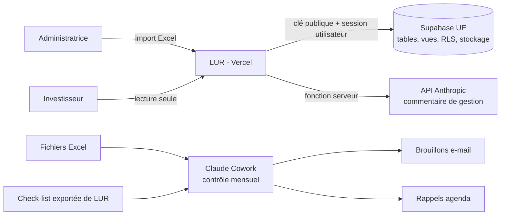

# LUR — Gestion de patrimoine immobilier tertiaire

LUR est l'outil interne d'une operating partner en immobilier tertiaire en Espagne. Les investisseurs (fonds, family offices) y consultent leur portefeuille en lecture seule. L'administratrice l'alimente par import Excel et produit un rapport trimestriel commenté par l'IA.

> Projet réalisé pendant une formation de 6 semaines en vibe coding. **Toutes les données sont fictives.**

Application en ligne : https://gallery-of-moments.vercel.app (accès sur invitation, non indexée)

---

## Le problème

Un investisseur immobilier reçoit son reporting en morceaux : fichiers Excel, PDF, e-mails, à des dates et dans des formats différents. Il ne sait jamais si le chiffre qu'il lit est le dernier, ni d'où il vient. LUR réunit tout le reporting au même endroit, à jour et traçable : chaque chiffre affiché indique le fichier, la version et la date dont il provient.

## Fonctionnalités du MVP

| Fonction | Pour qui | Ce qu'elle fait |
|---|---|---|
| **Connexion et rôles** | Tous | Connexion sécurisée ; un investisseur ne voit que son portefeuille, l'administratrice voit tout |
| **Tableau de bord** | Investisseur, admin | Valeur, loyers, occupation, LTV ; alertes (baux, covenants, vacance) ; loyers par actif ; liste des actifs ; source de chaque chiffre |
| **Fiche actif** | Investisseur, admin | Caractéristiques, baux et locataires, financement (encours, LTV, ICR, covenants), business plan, documents |
| **Import Excel contrôlé** | Admin | Modèle standard v1.2 ; aperçu et contrôles avant validation (onglets, colonnes, types, liens) ; erreurs bloquantes signalées avec onglet, ligne et correction attendue |
| **Rapport trimestriel** | Admin, investisseur | Commentaire de gestion rédigé par Claude à partir des seuls chiffres du trimestre, contrôle automatique des chiffres, PDF marqué « Confidentiel », brouillon d'e-mail, versions corrigées tracées |
| **Contrôle à la demande** | Admin | Bouton « Lancer le contrôle » : fraîcheur des données, alertes, état des rapports, check-list téléchargeable |
| **Cycle de vie (V1.1)** | Admin | Actif sorti du portefeuille (archivé, invisible pour l'investisseur), contacts des locataires réservés à l'admin, anonymisation (RGPD), compte désactivé |

## Règles métier

- **Excel fait foi.** Les chiffres financiers n'entrent que par un import validé. L'application ne calcule que des agrégations (totaux, occupation pondérée par la surface, LTV du portefeuille), dans des vues SQL.
- **Traçabilité.** Chaque chiffre est rattaché à l'import dont il provient ; un import remplacé est conservé.
- **Aucun envoi sans validation.** Rapports et e-mails sont relus et validés par l'administratrice.
- **Un actif = un investisseur**, rattaché à un identifiant unique.

## Stack

| Besoin | Outil |
|---|---|
| Maquettes | Stitch |
| Application | Lovable (TanStack Start, React, TypeScript) |
| Base de données, authentification, stockage | Supabase (région UE), Row Level Security |
| Versionnement et déploiement | GitHub (dépôt privé) + Vercel (fonctions en région Europe) |
| IA | API Anthropic, modèle Claude Sonnet 5.5, appelée uniquement côté serveur |
| Automatisation | Claude Cowork (contrôle mensuel) |

## Architecture



## Modèle de données

13 tables et 3 vues de calcul. Schéma complet : `docs/lur-schema-v1.1.dbml` (à visualiser sur dbdiagram.io).

- Tables : `investors`, `profiles`, `assets`, `imports`, `asset_kpis`, `units`, `tenants`, `tenant_contacts`, `leases`, `loans`, `bp_versions`, `documents`, `reports`.
- Vues (`security_invoker`) : `asset_current_import`, `asset_summary`, `portfolio_summary`.

## Sécurité

- RLS activée sur toutes les tables : l'administratrice lit et écrit tout ; l'investisseur lit uniquement son portefeuille ; aucun droit pour un visiteur non connecté. Détail : `docs/politiques-rls.md`.
- Côté navigateur, uniquement la clé publique Supabase. La clé de l'API Anthropic reste côté serveur (variable `ANTHROPIC_API_KEY`, sans préfixe `VITE_`).
- Liens de téléchargement signés et de courte durée.
- Site non indexé (`noindex`, robots.txt).
- Audits : `docs/audit-securite.md` (scan Lovable, Security Advisor de Supabase : 0 erreur) et `docs/audit-seo.md` (Lighthouse mobile : performance 98, accessibilité 100, bonnes pratiques 100).

## Lancer le projet en local

```bash
npm install
cp .env.example .env   # renseigner les variables ci-dessous
npm run dev
```

Variables d'environnement :

| Variable | Où | Rôle |
|---|---|---|
| `VITE_SUPABASE_URL` | navigateur | Adresse du projet Supabase |
| `VITE_SUPABASE_PUBLISHABLE_KEY` (ou `VITE_SUPABASE_ANON_KEY`) | navigateur | Clé publique Supabase |
| `ANTHROPIC_API_KEY` | serveur uniquement | Commentaire de gestion par l'IA |

Ne jamais ajouter la clé `service_role` de Supabase dans le dépôt ni dans une variable `VITE_`.

Base de données : exécuter `docs/schema.sql`, `docs/migration-v1.1.sql` puis `docs/seed.sql` dans Supabase › SQL Editor, puis créer les comptes de démonstration dans Authentication › Users.

## Données de démonstration

| Investisseur | Portefeuille |
|---|---|
| FAEB — Fonds Atlantique Europe Bureaux | 3 immeubles de bureaux à Madrid : 92,6 M€, 4,71 M€ de loyers, 93,0 % d'occupation, LTV 48,0 % |
| OFO — Ortega Family Office | 1 immeuble de bureaux à Barcelone |

Fichiers Excel de test : `docs/excel/` (modèle vide, fichier valide, fichier volontairement erroné).

## Documentation

| Thème | Documents |
|---|---|
| Cadrage | `note-de-cadrage.md`, `contexte-projet.md`, `perimetre-mvp.md`, `matrice-risques.md` |
| Produit | `prd.md`, `personae.md`, `hypotheses-produit.md`, `value-proposition-canvas-fusionnee.md`, `refinement-produit.md` |
| Maquettes | [`docs/maquettes-stitch.md`](docs/maquettes-stitch.md) : maquettes Stitch et prompts d'intégration dans Lovable (ancien README) |
| Conception | `prompts-stitch.md`, `prompts-lovable.md`, `lovable-knowledge.md`, `grille-stack.md` |
| Données | `schema.sql`, `migration-v1.1.sql`, `seed.sql`, `schema-supabase.md`, `lur-schema-v1.1.dbml`, `politiques-rls.md` |
| Qualité | `audit-securite.md`, `audit-seo.md` |
| Automatisation | `workflow-cowork.md` |

## Prochaines étapes (V2)

- Côté investisseur : historique et comparaison des versions de rapport, page Documents complète, export des données.
- Administration : gestion des investisseurs et des comptes, historique des imports.
- Envoi automatique des rapports, rappels de mise à jour des fichiers Excel.
- Extraction des données clés d'un bail PDF par l'IA, point marché à partir de sources réelles.
- Avant les données réelles : Supabase et Vercel en offre Pro, IA hébergée en Europe, sauvegardes, registre RGPD.

---

Projet de Célia — operating partner, immobilier tertiaire, Espagne.
